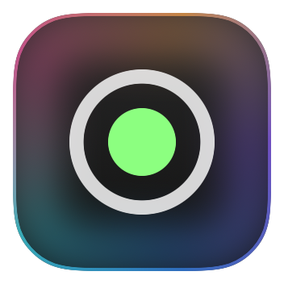
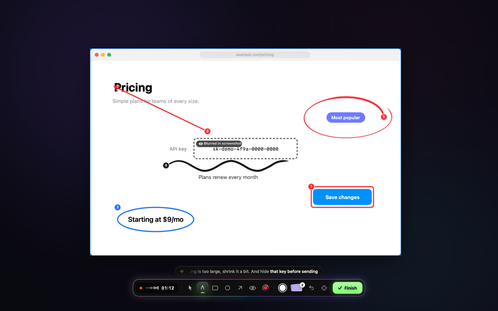
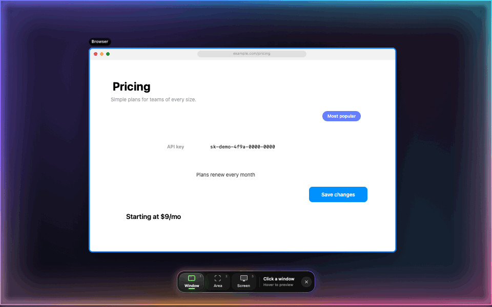
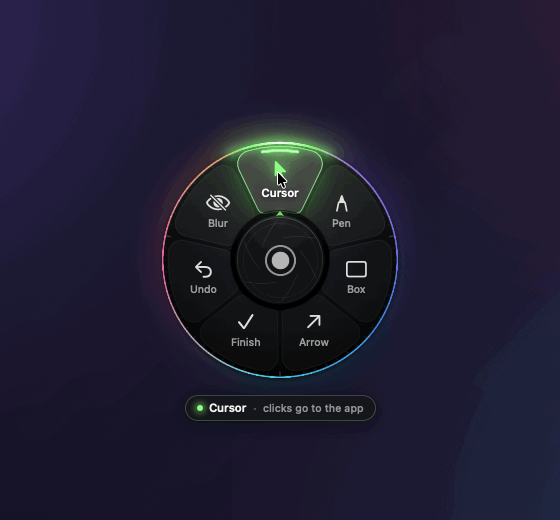
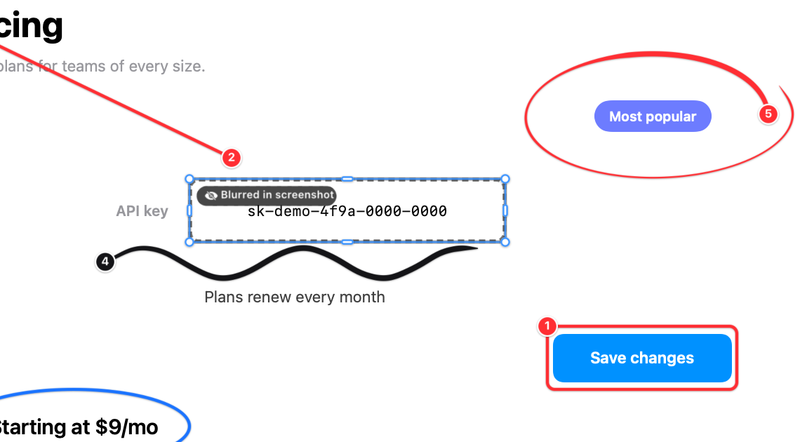
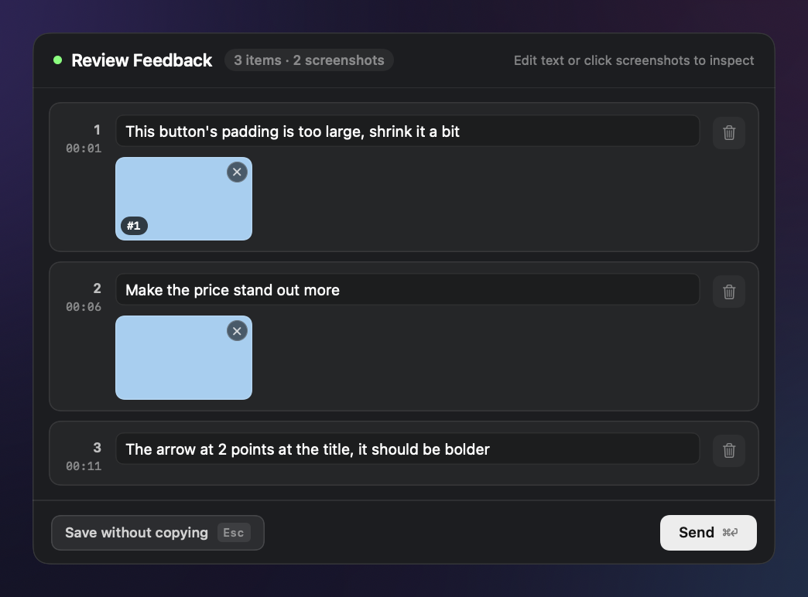
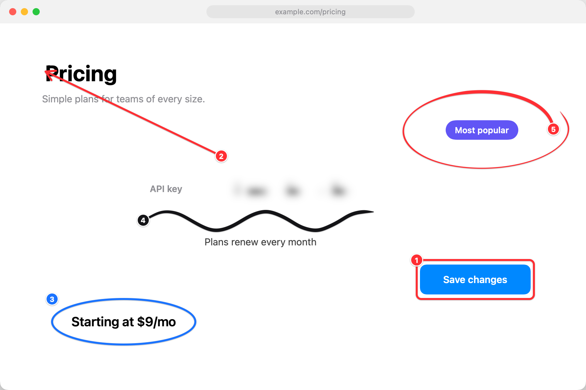
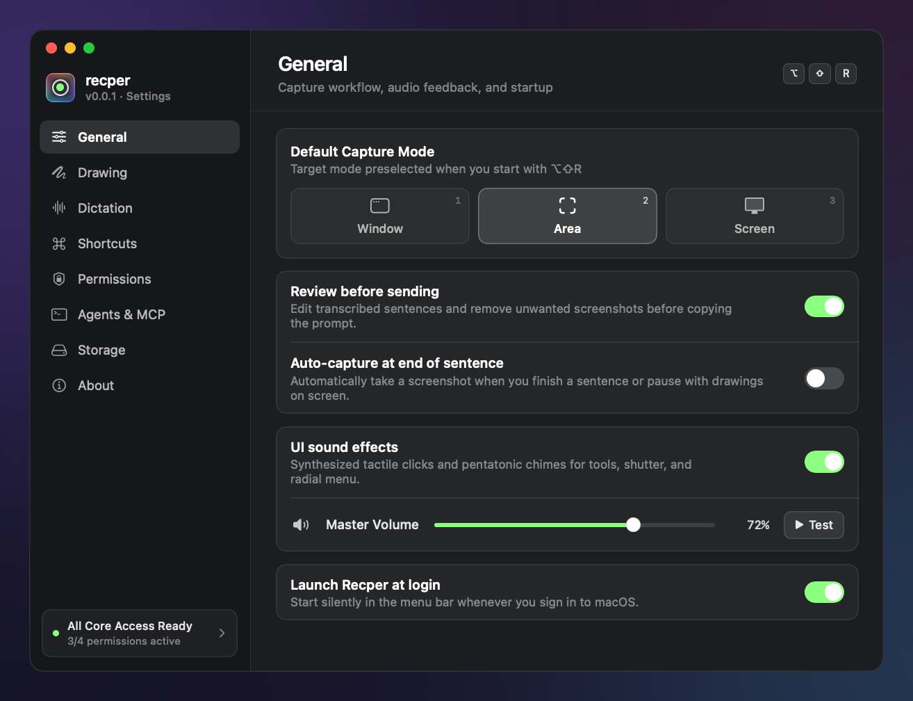
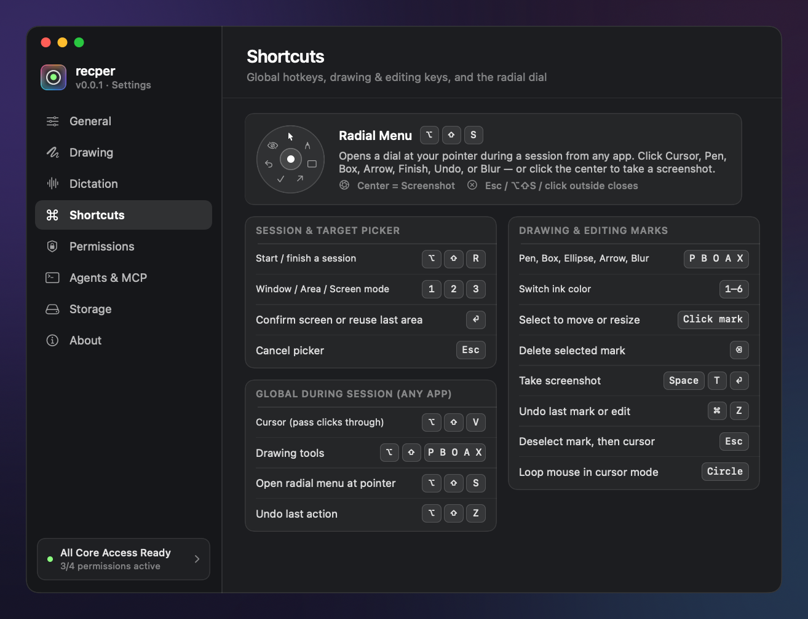
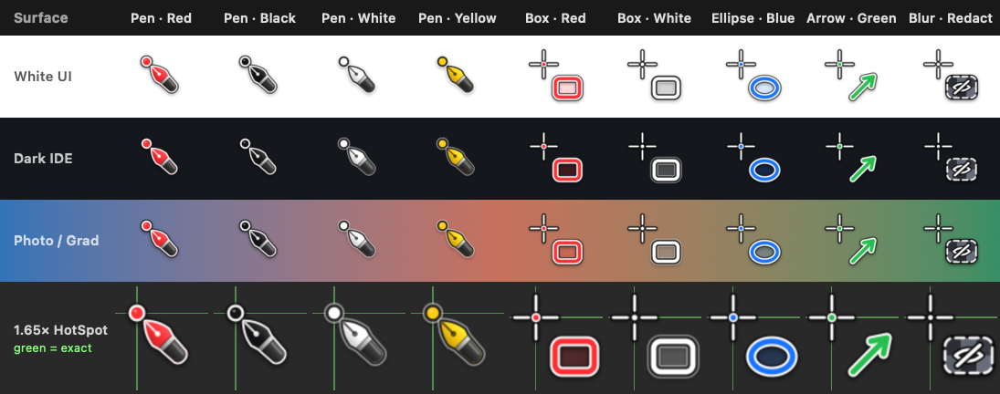

<div align="center">

<sub>💡 Inspired by <a href="https://x.com/jynniit/status/2123519487257514205">this post</a> · cc <a href="https://x.com/jynniit">@jynniit</a></sub>



# recper

**Talk and draw on your screen. Your coding agent gets a clean checklist with annotated screenshots.**

A tiny macOS menu-bar app for giving visual feedback to coding agents such as Claude Code, Codex or Antigravity.


[](LICENSE)



</div>

Instead of typing long descriptions or pasting screenshots one by one, you pick a window, area or screen, say what's wrong
and circle it. recper transcribes your speech on-device, captures screenshots with your marks burned in, binds each
screenshot to the sentence you were saying, and hands the result to your agent as a Markdown file, via the clipboard or over MCP.

It is not a screen recorder: no video, no audio files. Just text, numbered marks and screenshots.

## How it works

<table>
<tr>
<td width="50%" valign="top">

**1. Pick a target**

Press `⌥⇧R` and choose a window, an area or a whole screen. Everything outside the target is dimmed and the screen
edges light up while you choose.

</td>
<td width="50%"></td>
</tr>
<tr>
<td valign="top">

**2. Talk and draw**

Speak naturally; the live caption follows you. Draw with pen, box, ellipse, arrow or blur in six colors. Every mark gets
a number. Press `⌥⇧S` from any app for the radial menu at your pointer: pick a tool, undo, finish, or click the center
for a screenshot.

</td>
<td></td>
</tr>
<tr>
<td valign="top">

**3. Fix marks in place**

Click a box, ellipse, arrow or blur region to move it or resize it from its edges and corners; `⌫` deletes it.
Blur regions stay readable on screen as an outline and are pixelated only in the screenshot.

</td>
<td></td>
</tr>
<tr>
<td valign="top">

**4. Review and send**

Finish with `⌥⇧R` (or say "finish"). Fix sentences, drop screenshots you don't need, then send: the prompt is on your
clipboard and the files are on disk.

</td>
<td></td>
</tr>
</table>

### What your agent gets

Marks are burned into the screenshot with their numbers, and blurred regions are pixelated before anything is written to disk.



## Features

- **Pick a target**: window, area or full screen (`⌥⇧R`), with rounded frames and an aurora glow around the screen edges.
- **On-device dictation** with Apple's `SpeechAnalyzer` / `DictationTranscriber`; live captions while you talk; pick the language in Settings.
- **Draw & edit** with pen, box, ellipse, arrow and blur in 6 colors. Move, resize or delete marks until they are captured.
- **Circle gesture**: in cursor mode, circle something with the mouse (without clicking) to drop a numbered ellipse around it.
- **Radial menu** (`⌥⇧S`) at the pointer, from any app: cursor, pen, box, arrow, finish, undo, blur; the center takes a screenshot.
- **Numbered marks**: every mark gets a `#n` badge, and the UI element under it is looked up via Accessibility (role, title, identifier).
- **Screenshots** with a shutter: `Space` / `T` / `⏎` while drawing, the radial menu, or the button in the bar.
- **Voice commands**: "take screenshot", "undo", "finish".
- **Review screen** before sending (optional): edit sentences, inspect screenshots large, remove what you don't need.
- **Sounds**: short synthesized UI sounds (no audio files), with a volume setting.
- **Settings window** for defaults, dictation, shortcuts, permissions, agent setup and storage.
- **Output**: `feedback.md` checklist + `session.json` + `shots/*.png`, and a ready-to-paste prompt on the clipboard.
- **MCP server** (`Recper --mcp`) so agents can read feedback, check off items, and ask you for feedback themselves.

## Install

Download `Recper.zip` from the [latest release](https://github.com/imhalid/recper/releases/latest), unzip it and move
`Recper.app` to Applications. The app is ad-hoc signed (not notarized), so the first time, right-click it and choose
**Open**, or run `xattr -dr com.apple.quarantine /Applications/Recper.app`.

## Requirements

- macOS 26 or later, Apple Silicon
- Swift 6 toolchain (Xcode or just the Command Line Tools)

## Build and run

```sh
scripts/bundle.sh
open build/Recper.app
```

`bundle.sh` builds a release binary and wraps it in `build/Recper.app` with an ad-hoc signature.
Optionally run `scripts/dev-cert.sh` once to create a local self-signed signing identity, so macOS permissions
survive rebuilds.

## Permissions

| Permission | Why |
|---|---|
| Microphone | Live dictation. Audio is never recorded or saved. |
| Speech Recognition | On-device transcription. |
| Screen Recording | Capturing the selected window, area or screen. |
| Accessibility (optional) | Naming the UI element under each mark. |

The Settings window shows the live status of each permission with a button to grant it.

## Settings

Right-click (or ⌥-click) the menu-bar icon and choose **Settings…** (`⌘,`), or open `recper://settings`.

 

General (default mode, review, auto-capture, sounds, launch at login) · Drawing (default tool and color, circle gesture) ·
Dictation (language, on-screen terms) · Shortcuts · Permissions · Agents & MCP (copyable setup commands) · Storage · About.

## Shortcuts

| Key | Action |
|---|---|
| `⌥⇧R` | Start / finish a session |
| `1` / `2` / `3` | Target mode: window / area / screen (while choosing) |
| `P` `B` `O` `A` `X` | Pen, box, ellipse, arrow, blur |
| `1`–`6` | Ink color (while drawing) |
| `Space` / `T` / `⏎` | Take a screenshot (while drawing) |
| `⌘Z` | Undo the last mark, edit, deletion, or screenshot |
| `⌫` / `Delete` | Remove the selected mark |
| `Esc` | Deselect a selected mark; otherwise back to the cursor (clicks go to the app underneath) |
| Click & drag a mark | Move a box, ellipse, arrow or blur region; drag its edges, corners or ends to resize |
| Circle with the mouse | In cursor mode (without clicking), drop a numbered ellipse around what you circled |
| `⌥⇧S` | During a session, from any app: radial menu at the pointer; click an item, or the center for a screenshot. Click outside, `Esc` or `⌥⇧S` closes it |
| `⌥⇧V` `P` `B` `O` `A` `X` `Z` | During a session, from any app: cursor, pen, box, ellipse, arrow, blur, undo |
| `⌘⏎` / `Esc` (Review) | Send (save & copy prompt) / save without copying |

### Drawing cursors

Each tool has its own cursor with an exact hot spot and the current ink color, readable on light, dark and busy backgrounds.



## Output

Each session is saved to `~/.recper/sessions/<timestamp>/`:

```
feedback.md   session.json   shots/01.png 02.png ...
```

`feedback.md` is a checklist of what you said, with screenshots attached to the sentence they belong to:

```markdown
# Feedback — 2026-11-20 15:42

- [ ] 1. This button's padding is too large, shrink it a bit. [00:07]
  ↳ drawn while speaking: #1 (screenshot 1)
   — #1 box (10,20)–(110,60) → AXButton "Save"
- [ ] 2. The logo in the header is shifted left, center it. [00:15]
```

`session.json` holds the same data for machines: segments with timings, screenshots and mark coordinates.

## MCP

Register the server with your agent, for example Claude Code:

```sh
claude mcp add recper -- /path/to/Recper.app/Contents/MacOS/Recper --mcp
```

| Tool | What it does |
|---|---|
| `get_feedback` | Returns the latest (or a given) session: checklist text plus downscaled screenshots and mark summaries. |
| `list_sessions` | Lists recent sessions with duration, screenshot count, done/total items and the first sentence. |
| `mark_done` | Checks off (or unchecks) an item in `feedback.md`. |
| `request_feedback` | Opens recper on your screen (via `recper://start`), optionally with a question, and waits until you finish. |

## Privacy

Everything stays on your Mac. Speech is transcribed on-device, audio is never stored, and recper makes no network
requests. Blurred regions are blurred in the pixels before a screenshot is written to disk.

## Tests

```sh
scripts/test.sh
```

## Performance

recper is small and stays out of the way: it does nothing while idle, and its heavy work (burning marks into a
screenshot) takes a few tens of milliseconds.

### Size

| | Size |
|---|---:|
| Recper.app | 2.0 MB |
| Recper.zip (download) | 838 KB |
| Swift source | 11.4k lines |
| Tests | 40 |

No dependencies: AppKit, SwiftUI, ScreenCaptureKit, Speech and AVFoundation only. No audio or image assets; sounds are synthesized.

### Runtime

| State | CPU | Memory |
|---|---:|---:|
| Idle in the menu bar | 0.0 % | 10 MB |
| Choosing a target (edge glow on) | 9.8 % | 21 MB |
| Idle again after cancelling | 0.0 % | 22 MB |

Process start after `open`: ~90 ms. Animations run only while their window is on screen, and the sound engine
stops 3 s after the last sound.

### Hot paths (median)

| Operation | Input | Time |
|---|---|---:|
| Compose screenshot | 1800×1200, 5 marks + 1 blur region | 32.4 ms |
| Write PNG | 1800×1200 | 15.8 ms |
| Write `feedback.md` | 60 sentences, 25 screenshots | 0.19 ms |
| Circle gesture detector | per mouse-move event | 12–15 ns |
| Draw a tool cursor | 2× Retina, first use (cached after) | 0.36 ms |
| Synthesize a UI sound | 3 voices, 48 kHz stereo | 0.14 ms |

_Measured on an Apple M1 (16 GB), macOS 26.6. Reproduce with:_

```sh
scripts/bench.sh            # sizes, runtime CPU/memory and hot paths (relaunches recper)
build/Recper.app/Contents/MacOS/Recper --benchmark   # hot paths only
```

## Roadmap

- Optional local Whisper model for speech recognition
- Linux support
- Short motion clips alongside screenshots

## README media

The images above are rendered from synthetic scenes (no screen capture, no personal data):

```sh
$(swift build -c release --show-bin-path)/Recper --render-media docs/media
```

## Credits

The UI sounds follow the sound design of [chuanqisun/spaceship](https://github.com/chuanqisun/spaceship) (MIT License, © 2026 Sun).

## License

[MIT](LICENSE)
